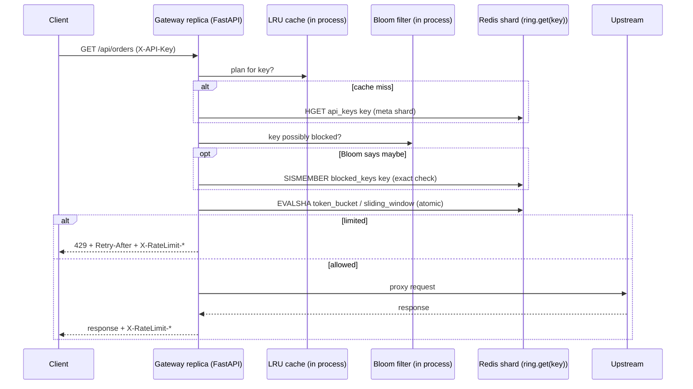
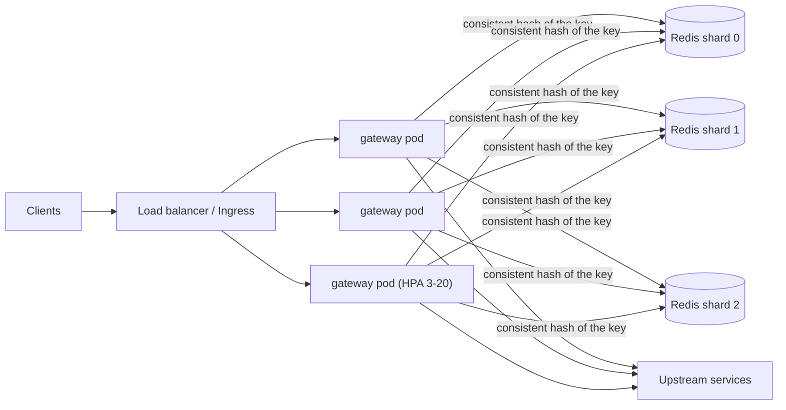

# ratelimit-gateway

An API gateway in Python (FastAPI) that authenticates API keys, rejects blocked keys and enforces **per-plan rate
limits that stay exact across many gateway replicas**, using Redis Lua scripts sharded with a consistent-hash ring.
Each data structure is implemented by hand and tested, because each one solves a real part of the problem:

| Problem | Data structure / algorithm | Cost |
|---|---|---|
| Allow bursts, then a steady rate | **token bucket** with lazy refill | O(1) time and memory per key |
| Hard "N per window" without boundary bursts | **sliding window log** (deque of timestamps) / **sliding window counter** (weighted previous window) | O(1) amortised / O(1) |
| Replicas must not over-admit under concurrency | **atomic Redis Lua script** per check, clock from `redis.call('TIME')` | one round trip |
| Spread keys over several Redis shards, add shards without resetting everyone | **consistent hashing ring** with 160 virtual nodes, `bisect` lookup | O(log V); adding a shard moves ~1/(n+1) keys |
| API-key → plan lookup on every request | **LRU cache** (hash map + doubly linked list, TTL) | O(1) get/put |
| "Is this key blocked?" for millions of keys | **Bloom filter** (k hashes by double hashing, sized from n and p) | O(k), no network call unless "maybe" |

## Results

_Filled from the CI run._

## Request path



## Deployment



- **Local / CI:** `compose.yaml` (3 Redis, 2 gateway replicas, an echo upstream).
- **Kubernetes:** `deploy/k8s/ratelimit.yaml`: Deployment with HPA, PDB, topology spread and a hardened security
  context; Redis as a StatefulSet with one shard per pod behind a headless Service.
- **AWS:** `terraform/aws`: one ElastiCache replication group per shard (Multi-AZ, automatic failover, TLS and
  at-rest encryption, reachable only from the gateway's security group). The `redis_urls` output plugs into
  `REDIS_URLS`.

## Run it

```bash
pip install -e ".[dev]" && pytest -q              # unit, property and stateful tests (no Docker needed)
docker compose up -d --build --wait
python scripts/loadtest.py                        # exactness, auth, latency, shard balance
```

## Design notes (interview talking points)

- **Why Lua and not GET + SET?** Two replicas can both read "1 token left" and both allow. A Lua script runs
  atomically on the Redis server, so check-and-decrement is one indivisible step.
- **Why `TIME` inside the script?** Replicas' clocks drift; using the Redis server clock makes refills consistent.
- **Why consistent hashing?** `hash(key) % n` remaps about 75% of keys when going from 3 to 4 shards, resetting their
  limits; the ring moves about 25%, and only to the new shard (tested).
- **Why a Bloom filter in front of Redis?** Almost no request uses a blocked key; the filter answers "definitely not
  blocked" locally. False positives only cost one extra Redis call, and there are no false negatives.
- **Failure mode:** if Redis is unreachable the gateway returns an error (fail closed). Fail-open with a local
  token bucket is a one-line policy change, and a trade-off to discuss: availability vs abuse protection.
