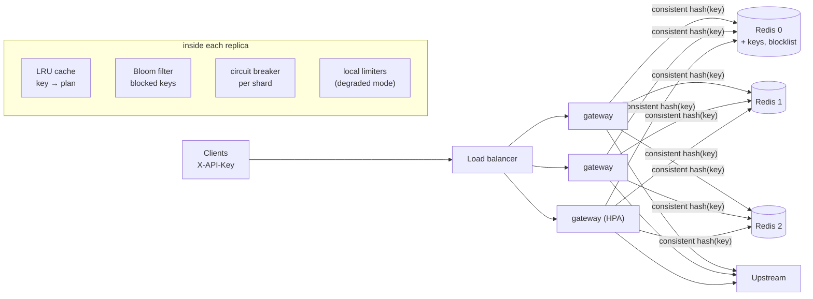
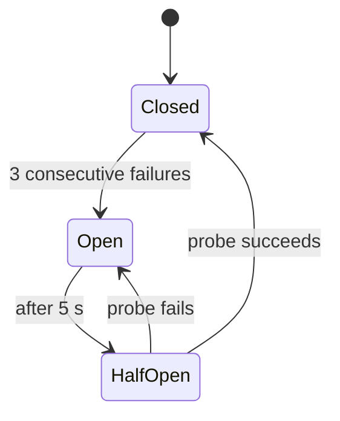

# ratelimit-gateway: architecture

## 1. Context

A public API needs per-customer limits ("free: 10 requests then 1 per second; pro: 600 per minute") that hold no matter how many gateway replicas run. A limit kept in each replica's memory multiplies by the replica count and resets on every deploy. A naive shared counter (GET, compare, SET) over-admits under concurrency. And whatever stores the counters must not become a single point of failure for the whole API.

This gateway authenticates API keys, rejects blocked keys, enforces the plan limits exactly across replicas with atomic Redis scripts on a sharded Redis tier, and keeps working, deliberately degraded, when a shard is down.

## 2. Components

| Module | Responsibility |
|---|---|
| `rlg/gateway.py` | FastAPI app: authentication, the blocklist check, the rate-limit decision, the degraded-mode policy, the proxy, headers and metrics |
| `rlg/redis_limiter.py` | Lua scripts (token bucket, sliding window counter), shard selection, the circuit breaker around every call |
| `rlg/breaker.py` | The circuit breaker: closed → open → half-open → closed |
| `rlg/hashring.py` | Consistent-hash ring, with 160 virtual nodes per shard and `bisect` lookup |
| `rlg/limiters.py` | In-process algorithms: token bucket, fixed window, sliding window log and counter. Used for the degraded mode, and as references in the tests |
| `rlg/lru.py` | LRU cache with TTL: a hash map plus a doubly linked list, O(1) |
| `rlg/bloom.py` | Bloom filter sized from n and p, with k positions by double hashing |

## 3. Request path

1. **Authenticate.** Look up the plan in the LRU cache (30 s TTL); on a miss, `HGET api_keys` on the first shard.
2. **Blocklist.** The Bloom filter answers "definitely not blocked" locally. Only a "maybe" costs a `SISMEMBER`. The filter is rebuilt every 10 s and swapped in atomically, so readers never see a half-built filter.
3. **Decide.** One `EVALSHA` on the key's shard. The script reads the clock with `redis.call('TIME')`, then checks and updates the counters in one atomic step.
4. **Respond.** Proxy upstream with `X-RateLimit-Limit`, `-Remaining` and `-Plan`, or return 429 with `Retry-After`.

**Why each piece:**
- **Lua, not GET then SET:** two replicas could both read "1 token left" and both allow. A script runs atomically, so that race can't happen. In CI, 200 concurrent requests across replicas admit exactly 50.
- **Server time, not replica time:** replica clocks drift, which would make refills inconsistent.
- **Consistent hashing:** with `hash % n`, adding a 4th shard remaps about 75% of keys and resets their limits. The ring moves about 25%, all of them to the new shard (tested).
- **Bloom filter:** almost no request uses a blocked key, so the network call is skipped for nearly everyone. There are no false negatives.

## 4. Algorithms

| Algorithm | State per key | Behaviour | Used for |
|---|---|---|---|
| Token bucket, with lazy refill | (tokens, timestamp) | Bursts up to the capacity, then a steady rate | Plans with bursts (`free`, `burst`) |
| Sliding window counter | Two counters (this window, the previous one) | Approximates a true sliding window by weighting the previous window by its overlap | Hard "N per minute" plans (`pro`), without the 2× edge burst a fixed window allows |
| Sliding window log | Deque of timestamps | Exact, O(limit) memory | In-process degraded mode, and as a test reference |

## 5. Degraded mode (a shard is down)

- **The breaker** stops every request from waiting out the OS socket timeout on a dead shard (or the 1 s client timeout), which would otherwise pile up connections on every replica. While it's open, the decision is instant. While it's half-open, exactly one probe goes through and everyone else stays degraded.
- **The policy** (`FAIL_MODE`) is a product decision made explicit:
  - `local`: each replica enforces `ceil(limit / GATEWAY_REPLICAS)` in process.
  - `open`: allow everything.
  - `closed`: return 503.
- **Responses** are marked with `X-RateLimit-Degraded`, and `gateway_degraded_decisions_total{mode}` and `gateway_shard_circuit_open{shard}` make the outage visible.
- **Why `local` is approximate:** each replica sees only its own share of traffic. If traffic is spread evenly over N replicas, the fleet admits about the limit. If the load balancer sends one client's traffic mostly to one replica, that client gets less. If more replicas run than `GATEWAY_REPLICAS` says, the fleet admits more. Set it to the HPA's `minReplicas` and accept bounded over-admission for the duration of the outage. Even under this approximation, the abuse protection still holds.
- **Authentication never degrades to "allow":** if the first shard (keys and blocklist) is down, cached keys keep working, and unknown keys get 503 in every mode.
- **Liveness doesn't depend on Redis.** A liveness probe that pings Redis would restart every gateway pod during a shard outage, turning a partial outage into a total one. `/healthz` reports the breaker states without failing.
- **The timeout must sit above the backend's p99 under load.** The first kind run used a 250 ms client timeout. A 200-request burst on a busy CI runner pushed some Redis calls past it, the breakers opened although every shard was healthy, and the pods fell back to their local shares: 101 requests admitted against a limit of 50. A false trip in a breaker is an outage of its own, so the default is now 1 s: still bounded, still far below an OS-level TCP timeout, but above the latency the shards show under that burst. The rule is to set the timeout from the measured p99, and alert on breaker trips (`gateway_shard_circuit_open`) so a false trip is seen.
- **A cache miss must not become a stampede.** Raising the timeout alone didn't fix the kind run (84 admitted against 50). The burst was 200 concurrent requests for a key that none of the 3 pods had cached yet, so every request did its own `HGET` for the plan, and each opened a new connection: a connection storm on the shards, timeouts, open breakers, local decisions. Two fixes:
  - **single flight**: concurrent misses for the same key wait on one shared lookup (`State.plan_for`; a test checks 100 concurrent misses make 1 Redis call);
  - **a bounded, blocking pool per shard** (`REDIS_POOL_SIZE`, default 32): bursts queue for a connection instead of opening hundreds.

  Breaker trips and recoveries are now logged, so the next false trip is visible in the pod logs, not only in the numbers.
- **After recovery:** a restarted shard comes back empty (counters aren't persisted), so its keys get a fresh bucket. That's the right trade-off for rate limits: counters are short-lived, and persisting them would cost write latency on every request.

## 6. Deployment

- **Compose:** 3 Redis shards, 2 gateway replicas and an echo upstream, used by CI for the load and chaos tests.
- **Kubernetes:**
  - Gateway Deployment with an HPA (3–20), a PDB and topology spread.
  - Non-root, seccomp `RuntimeDefault`, a preStop sleep so endpoints drain before shutdown.
  - Redis as a StatefulSet, one shard per pod behind a headless Service.
- **AWS:** Terraform for one ElastiCache replication group per shard: Multi-AZ with automatic failover, TLS and at-rest encryption, reachable only from the gateway's security group. With ElastiCache failover, a shard outage lasts seconds, and the degraded mode covers exactly that window.

## 7. Scaling and performance

- **Per request:** one LRU lookup, one Bloom check and one Redis round trip. Gateways are stateless, so they scale horizontally.
- **Redis load:** about one script call per request, spread over shards by the ring. Add shards for throughput; the ring keeps 75% of keys in place.
- **Latency:** the CI figures are indicative only, because a shared runner also runs the load generator and all the backends.

## 8. Security

API keys come in a header and are never logged or forwarded upstream (`x-api-key` is stripped). Blocked keys are refused with 403. There is no anonymous path. Redis is private: a NetworkPolicy and a security group, plus TLS on ElastiCache.

## 9. Testing

| Level | What it proves |
|---|---|
| Unit and property tests (Hypothesis) | Each algorithm against a reference; LRU stateful test against a model; Bloom filter false-positive rate below 2% with no false negatives; the ring moves about 1/(n+1) of keys when a shard is added |
| Lua against fakeredis (a real Lua VM) | Token bucket exact under 100 concurrent calls; sliding window; keys spread over shards |
| Degraded mode | Breaker transitions with a fake clock; an open breaker stops calling the dead shard after 3 attempts; `local` enforces the replica's share and marks responses while healthy shards stay exact; `open` and `closed` behave as specified; an unknown key is refused when the key store is down, even in `open` mode |
| Compose (CI) | Exactness across 2 replicas, auth, latency, shard balance; then **chaos**: stop a shard during traffic and bring it back |
| kind (CI) | 3 gateway pods and 3 Redis pods, with the load test as an in-cluster Job |

## 10. Next steps

- Per-tenant quotas over longer windows (daily or monthly), using Redis with persistence, unlike the short-lived rate counters.
- Replica count from the Kubernetes API (watching the Deployment) instead of a fixed `GATEWAY_REPLICAS`.
- Adaptive limits that tighten automatically when the upstream's error rate rises (load shedding).
